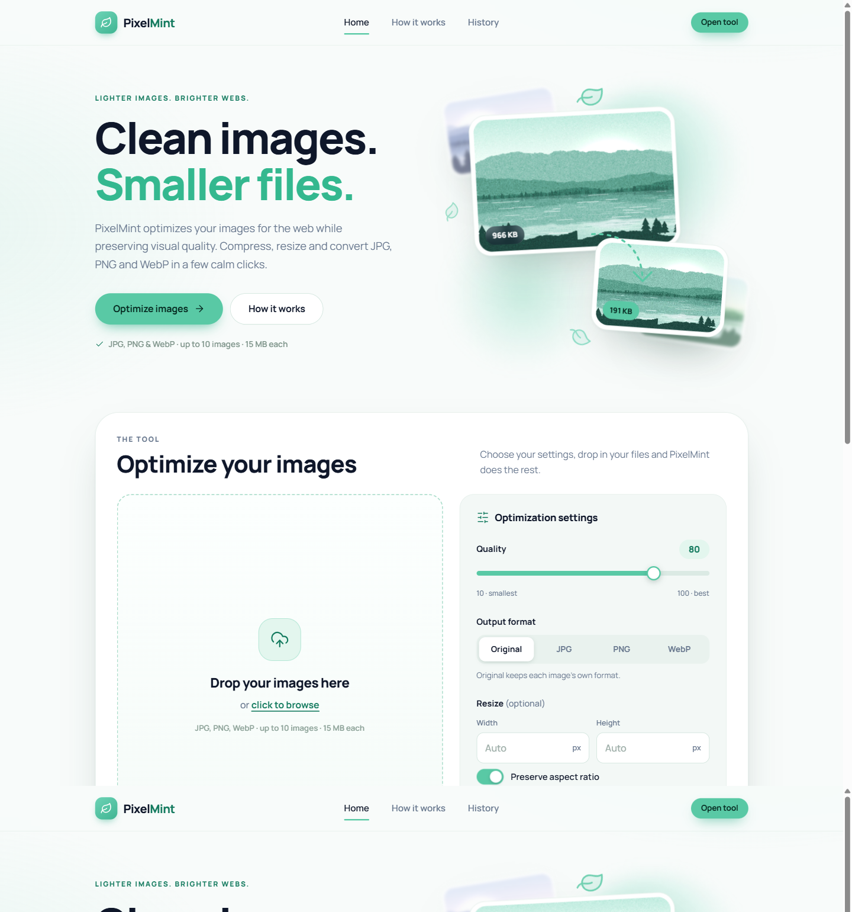

# PixelMint

[](https://www.python.org/)
[](https://www.djangoproject.com/)
[](https://python-pillow.org/)
[](https://www.sqlite.org/)
[](LICENSE)

**A modern Django image optimization tool for compressing, resizing, converting and managing images with a clean responsive interface.**

PixelMint is a polished image optimization web application built with Django and Pillow. It was created and developed by **Salah Al-Deen Saeed Abu Saif**.



## Overview

Oversized images are one of the most common reasons web pages load slowly. Getting them ready for the web usually means juggling desktop editors, command-line tools or online services that upload your files to a third party.

PixelMint solves this with a self-hosted, browser-based workflow. Drop in up to ten JPG, PNG or WebP files, choose a quality, an optional size and an output format, and PixelMint returns lighter files together with honest before/after statistics. Everything runs on your own machine: the Django backend validates each upload, Pillow does the processing, and the results are stored with a browsable history. In other words, it is a Django image optimizer with a user interface designed to stay out of the way.

## Key Features

- **Drag-and-drop uploads** with instant thumbnails, plus a regular file picker
- **Multi-image processing**: up to 10 images per batch, 15 MB each
- **JPG / JPEG / PNG / WebP** input
- **Compression quality control** from 10 to 100 (default 80) with a live value readout
- **Resizing** by width and/or height with **aspect-ratio preservation** (images are never enlarged)
- **Format conversion**: keep the original format or convert to JPG, PNG or WebP
- **Transparency-safe JPG conversion**: transparent areas are composited onto white instead of turning black
- **Before/after statistics**: dimensions, file sizes, bytes saved and reduction percentage. Results that end up *larger* than the source are reported as such, not hidden
- **Individual downloads** and a **ZIP download** for the whole batch
- **Optimization history** stored in SQLite, newest first, paginated
- **Django Admin integration** with thumbnails, filters and search
- **Responsive UI** for desktop, tablet and mobile
- **Friendly validation** messages instead of error pages
- **Real image-content validation** using Pillow (file extensions are not trusted)
- **UUID-based file handling** so uploads can never overwrite each other

Implementation details worth noting:

- EXIF orientation is applied to the pixels before resizing
- ICC colour profiles are preserved (except when converting from CMYK and similar modes)
- Corrupted and truncated images are detected and rejected
- Decompression-bomb protection through a pixel-count limit
- Safe, bounded display and download filenames

## Technology Stack

| Layer | Technologies |
| --- | --- |
| Backend | Python 3.13, Django 5.2, SQLite3, Pillow |
| Frontend | Django Templates, HTML5, CSS3, vanilla JavaScript, self-hosted Manrope font |
| Development | Git, automated Django test suite |

No frontend framework, build step or CDN is required.

## Architecture

```
config/                       Django project (settings, root URLs)
optimizer/
  models.py                   OptimizationRecord: metadata and file paths only
  forms.py                    Upload and settings validation
  views.py                    Thin HTTP views: home, results, history, downloads, error pages
  admin.py                    Django Admin configuration
  services/
    image_processing.py       Pure Pillow logic: validate, orient, resize, convert, encode
    batch.py                  Runs a batch, stores files and history rows
    naming.py                 UUID storage names and safe display/download filenames
  templates/optimizer/        Base, home, results, history and error templates
  static/optimizer/
    css/                      base.css, components.css, pages.css
    js/app.js                 Drag and drop, previews, client-side checks, loading state
    fonts/                    Manrope (SIL Open Font License)
    img/                      Generated demo images for the landing visuals
  tests/                      Unit and integration tests
tools/generate_demo_assets.py Regenerates the demo images with Pillow
docs/assets/                  README screenshot
```

The responsibilities are deliberately separated: views handle HTTP only, `image_processing.py` knows nothing about requests or the database, `batch.py` coordinates processing and persistence, and `naming.py` owns every decision about filenames.

## Image Processing Workflow

```
Upload -> Validation -> Pillow processing -> Resize / Convert / Compress
       -> Save result -> Store metadata -> Download / History
```

1. **Upload**: the form accepts the files and the optimization settings.
2. **Validation**: each file is checked by name, size and, most importantly, by opening it with Pillow.
3. **Processing**: EXIF orientation is applied, the image is normalised to a safe colour mode, resized, converted and encoded.
4. **Storage**: the original and the optimized file are written to `MEDIA_ROOT` under random UUID names.
5. **Metadata**: a row with formats, dimensions, sizes, quality and reduction percentage is saved to SQLite. **Binary image data is never stored in the database.**
6. **Results**: the user can preview, download each file or the whole batch as a ZIP, and revisit everything on the History page.

One invalid file never blocks the rest of a batch: valid images are processed and the failures are listed with a clear reason.

## Validation & Safety

- Actual image validation: Pillow must be able to open and fully decode the file
- Format restrictions: only JPEG, PNG and WebP content is accepted, and the detected format wins over the file extension
- 15 MB per-image limit and 10-image batch limit
- Corrupted or truncated images are rejected cleanly
- Decompression-bomb handling: images above 60 megapixels are rejected, and Pillow's own bomb error is also caught
- Safe filenames: stored files use server-generated UUID names; client names are stripped of paths and control characters and only used for display and downloads
- CSRF protection on the upload form
- Expected user errors are shown as friendly messages; unexpected errors are logged and shown generically
- With `DJANGO_DEBUG=0` the app refuses to start unless `DJANGO_SECRET_KEY` is set

## Installation

### Windows (PowerShell)

```powershell
git clone <repository-url>
cd pixelmint-image-optimizer

py -3 -m venv .venv

.\.venv\Scripts\python.exe -m pip install -r requirements.txt

.\.venv\Scripts\python.exe manage.py migrate

.\.venv\Scripts\python.exe manage.py runserver
```

Then open **http://127.0.0.1:8000/**

Optionally create an administrator for `/admin/`:

```powershell
.\.venv\Scripts\python.exe manage.py createsuperuser
```

### Linux / macOS

```bash
git clone <repository-url>
cd pixelmint-image-optimizer

python3 -m venv .venv
source .venv/bin/activate
pip install -r requirements.txt

python manage.py migrate
python manage.py runserver
```

### Configuration

Limits such as `OPTIMIZER_MAX_FILE_SIZE`, `OPTIMIZER_MAX_FILES` and `OPTIMIZER_MAX_PIXELS` live in `config/settings.py`. Optional environment variables: `DJANGO_DEBUG` (default `1`), `DJANGO_SECRET_KEY` and `DJANGO_TIME_ZONE` (default `UTC`, for example `Africa/Cairo`).

## Running Tests

```powershell
.\.venv\Scripts\python.exe manage.py test
```

The suite currently contains **86 tests, all passing**. Test images are generated programmatically with Pillow, and every test runs against a temporary `MEDIA_ROOT` that is deleted afterwards, so no files are left behind. Coverage includes JPG, PNG and WebP processing, resizing and aspect ratio, format conversion, transparency, EXIF orientation, invalid and corrupted files, size and batch limits, downloads, ZIP output, history, the admin and static-asset integrity.

You can also run the Django checks:

```powershell
.\.venv\Scripts\python.exe manage.py check
.\.venv\Scripts\python.exe manage.py makemigrations --check
```

## Project Highlights

- **Separation of concerns**: image-processing logic lives in a framework-independent service module instead of the views.
- **Safe file storage**: UUID-named files, an untouched copy of every original, and cleanup of files when a history record is deleted.
- **No frontend frameworks**: the responsive interface is hand-written HTML, CSS and vanilla JavaScript, with a self-hosted font.
- **Honest numbers**: all statistics come from the real files, including the case where an optimized image grows.
- **Programmatic test data**: tests build their own images with Pillow, covering edge cases such as palette PNGs, 16-bit grayscale, CMYK JPEGs, rotated EXIF images and animated WebP.
- **Accessibility**: labelled controls, visible focus states, ARIA attributes on the dropzone and live regions, and a `prefers-reduced-motion` fallback that disables animations.
- **Partial success**: one failing file never discards the rest of a batch.

## Current Limitations

- **PNG output is lossless**, so the quality slider has no effect on PNG files; they are re-encoded with maximum compression instead.
- **Animated images** (for example animated WebP) are reduced to their first frame, and a warning is shown.
- **EXIF metadata is stripped** from the output (orientation is applied first, ICC profiles are kept).
- **No authentication**: the history is shared by everyone who can reach the site.
- **Development configuration**: `DEBUG` defaults to on, `/media/` is served by Django's development server only, and the HTTPS-related production settings are not configured. This repository is not a production deployment.
- Originals and optimized files are both kept in `media/` until the history record is deleted.

## Future Improvements

These are ideas, not implemented features:

- Authentication and per-user history
- AVIF support
- Asynchronous processing for large batches
- Cloud / object storage for media
- Production deployment configuration
- CI/CD pipeline

## Author

### Salah Al-Deen Saeed Abu Saif

Software Engineer / Odoo & Python Developer

PixelMint was designed and developed as a practical Django image-processing project demonstrating backend development, file handling, image manipulation, validation, automated testing and responsive frontend implementation.

## License

Released under the [MIT License](LICENSE). Copyright (c) 2026 Salah Al-Deen Saeed Abu Saif. The bundled Manrope font is distributed under the SIL Open Font License.
